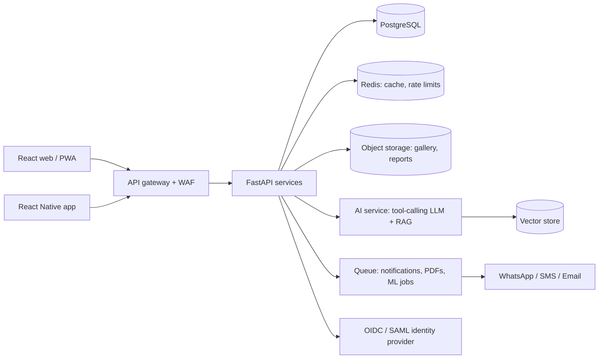

# Roadmap: from this MVP to a production, future-ready platform

## Phase 0 — Done (this repo)
Multi-school platform (superadmin, school owners, staff with granular permissions, student logins),
students, marks analytics, fees, staff pages with photos, subjects with chapters, events, gallery
uploads, goals, about, users and access management, student photo approval flow, role- and
school-scoped grounded chatbot. SQLite and local disk uploads for local use.

## Phase 1 — Production hardening (2–4 weeks)
- PostgreSQL + Alembic migrations (replace SQLite and `create_all`)
- Move photo/gallery uploads to object storage (virus scan, signed URLs)
- Marks entry grid per class and test
- Force password change on first login for generated temporary passwords
- SSO via OpenID Connect/SAML, MFA for admins, refresh tokens in httpOnly cookies, persistent login lockout (Redis)
- Audit log of every write (who changed marks/fees and when)
- Containerise on `registry.redhat.io/ubi9/python-312-minimal` and a UBI nginx image, non-root, read-only FS
- CI: SAST, dependency scan, tests, lint on every commit; structured JSON logging

## Phase 2 — Things you may be missing
1. **Attendance** (daily, per period; low-attendance alerts to parents)
2. **Timetable** and teacher substitution
3. **Homework / assignments** and study material
4. **Parent and student portals** (own login: marks, fees, attendance, notices)
5. **Online fee payment** (UPI / payment gateway), receipts as PDF, instalment reminders
6. **Report cards** (PDF) with remarks, promotion to next class at year end
7. **Notifications**: WhatsApp / SMS / email for fees, absences, events, results
8. **Admissions & enquiry** pipeline, TC / certificates
9. **Staff payroll, leave, staff attendance**
10. **Transport** (routes, buses, live tracking), **hostel**, **library**, **inventory**
11. **Health records**, incident / discipline log, counsellor notes (strict access control)
12. **Multi-branch** support and academic-year rollover tooling

## Phase 3 — AI and futuristic
- **LLM chatbot with tool-calling**: model chooses from a fixed set of safe read-only tools (student summary, fee status, timetable) rather than free SQL; per-role permissions; citations back to records
- **Early-warning model**: predicts students likely to fail or drop out from marks trend, attendance, fee delays; suggests interventions
- **Personalised learning**: topic-level weakness detection, auto-generated practice sets and revision plans per student
- **Teacher copilot**: lesson plans, question-paper generation, auto-grading of written answers (human in the loop)
- **Parent assistant** in regional languages (Telugu, Hindi) incl. voice
- **Semantic search / RAG** over circulars, policies and syllabus documents (vector store)
- **Face / QR attendance** (privacy-reviewed, consent based)
- **Analytics warehouse** and what-if dashboards for management
- **Mobile apps** (React Native) and PWA offline mode; push notifications
- **Responsible AI**: PII minimisation, no student data sent to third-party models without consent, prompt-injection filtering, human review of automated decisions about children

## Suggested target architecture

